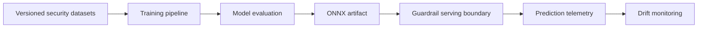

# Architecture

## Purpose

The LLM Security Guardrail Classifier is intended to classify inbound prompts for prompt
injection and jailbreak risk before those prompts reach a protected language model.

## Planned system boundaries

1. **Data** — versioned raw and processed security datasets managed through DVC.
2. **Training** — reproducible experiments tracked in MLflow, followed by ONNX export.
3. **Evaluation** — golden-dataset benchmarks and release acceptance criteria.
4. **Serving** — a low-latency FastAPI or BentoML boundary backed by ONNX Runtime.
5. **Monitoring** — prediction telemetry and Evidently AI drift reports.

No implementation is included in the initial scaffold. Components must be introduced through
reviewed design proposals and accompanied by tests, model documentation, and threat analysis.

## Data flow

## Reliability principles

- Failures must be observable and must not silently permit unsafe traffic.
- Model artifacts must be immutable, checksummed, and traceable to data and source revisions.
- Online and offline feature preparation must share a reviewed contract.
- Security thresholds must be calibrated against documented false-positive and false-negative
  tolerances.

