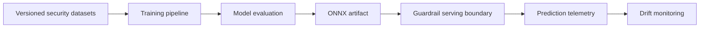

# Architecture

## Purpose

The LLM Security Guardrail Classifier is intended to classify inbound prompts for prompt
injection and jailbreak risk before those prompts reach a protected language model.

## Planned system boundaries

1. **Data** — versioned raw and processed security datasets managed through DVC.
2. **Training** — a reproducible DistilBERT fine-tuning pipeline that exports a checksummed ONNX
   artifact; MLflow experiment tracking is planned.
3. **Evaluation** — golden-dataset benchmarks and release acceptance criteria.
4. **Serving** — a low-latency FastAPI or BentoML boundary backed by ONNX Runtime.
5. **Monitoring** — prediction telemetry and Evidently AI drift reports.

Data ingestion and the training pipeline are implemented; evaluation, serving, and monitoring are
still placeholders. Components must be introduced through reviewed design proposals and
accompanied by tests, model documentation, and threat analysis.

## Data flow

## Training pipeline

`DistilBertPipeline` in `src/training/distilbert_pipeline.py` implements the stages of the generic
`TrainingPipeline` in `src/training/pipeline.py`:

1. **Load** the DVC-managed `train` and `validation` JSONL splits, hashing the files before and
   after parsing. The golden evaluation set is never trained on; it is only read to reject
   overlap.
2. **Prepare** by validating and tokenizing. Invalid data raises instead of being repaired:
   unexpected splits, missing columns, blank or oversized text, non-integer labels, or a missing
   class. Leakage is checked on what the model sees: inputs that are equal after tokenization
   (differing only in case, whitespace, or beyond the truncation limit) must not appear in both
   splits, and none may appear in the golden file. Error messages contain counts and row indices,
   never prompt text.
3. **Train** with a base-model revision pinned to a commit SHA and `config.random_seed`, keeping
   the checkpoint with the best validation malicious-class F1.
4. **Evaluate** on the validation split: malicious-class precision, recall, and F1, false-positive
   and false-negative rates, and a per-`attack_type` breakdown.
5. **Export** to `<output_directory>/export/`: `model.onnx`, the tokenizer, and `manifest.json`
   (lineage, settings, library versions, validation metrics, and a SHA-256 for every file). Export
   refuses a model with the wrong label mapping, one whose validation predictions are all a single
   class, and a run whose dataset files changed after loading. The ONNX graph is checked against
   PyTorch with ONNX Runtime before publishing, this pipeline never overwrites an existing export,
   and a failed export leaves nothing behind.

Serving must load the exported tokenizer and follow the manifest's `inference_contract`: the same
maximum sequence length (longer prompts are truncated), input and output names, label mapping,
and `argmax` decision rule.

## Reliability principles

- Failures must be observable and must not silently permit unsafe traffic.
- Model artifacts must be immutable, checksummed, and traceable to data and source revisions.
- Online and offline feature preparation must share a reviewed contract.
- Security thresholds must be calibrated against documented false-positive and false-negative
  tolerances.

