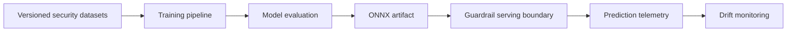

# Architecture

## Purpose

The LLM Security Guardrail Classifier is intended to classify inbound prompts for prompt
injection and jailbreak risk before those prompts reach a protected language model.

## Planned system boundaries

1. **Data** — versioned raw and processed security datasets managed through DVC.
2. **Training** — a reproducible DistilBERT fine-tuning pipeline that exports a checksummed ONNX
   artifact; MLflow experiment tracking is planned.
3. **Evaluation** — golden-dataset benchmarks and release acceptance criteria.
4. **Serving** — a FastAPI service backed by ONNX Runtime, in shadow mode.
5. **Monitoring** — prediction telemetry and Evidently AI drift reports.

Data ingestion, the training pipeline, the golden-set evaluator, the release benchmark, model
versioning, and shadow-mode serving are implemented; cloud deployment and monitoring are not
yet. Components must be introduced through reviewed design proposals and accompanied by tests,
model documentation, and threat analysis.

## Data flow



## Data ingestion

`src/data/ingestion.py` (`uv run python -m src.data.ingestion`) builds the DVC-tracked datasets:

1. **Fetch** three Hugging Face datasets, each pinned to a commit SHA: `deepset/prompt-injections`
   (injection and benign), `databricks/databricks-dolly-15k` (benign), and
   `jackhhao/jailbreak-classification` (jailbreak and benign, Apache-2.0, one pinned CSV file).
   Ten curated hard negatives are added.
2. **Validate** every row against `PromptRecord`. The attack type fixes the label: `benign` and
   `hard_negative` are 0, `injection` and `jailbreak` are 1. A row whose text is blank, too short,
   or too long is rejected and counted. A missing or unknown label, a source with no rows, or a
   source that rejects more than 5% of its rows raises `IngestionError`.
3. **Deduplicate** on the model input and keep the first copy. Texts are compared as the
   training tokenizer encodes them, truncated to `max_sequence_length`, using the base model and
   revision in `configs/model/classifier.yaml`. This is the same test the training pipeline
   applies, so long templates that differ only after the truncation point count as one example.
   An input that arrives with both labels raises `LabelConflictError`. Changing the base model or
   `max_sequence_length` means re-running ingestion; the training leakage check reports when it
   is needed.
4. **Split** into the golden set (200 rows), train, and validation, stratified on `attack_type`.
   Ingestion refuses data in which any attack type has no rows, so every slice can be measured.
5. **Record lineage** in `data/raw/ingestion_manifest.json`: source revisions and files, rows
   read, rejected and kept, the seed, and attack-type counts for each split.

Logs and errors contain counts and row indices, never prompt text.

## Training pipeline

Run training from the repository root with
`uv run python -m src.training.train [overrides...]`, for example `training.batch_size=8`. The
entry point composes `configs/config.yaml` with Hydra and validates the `model` and `training`
sections: unknown keys, wrong types, and a missing base-model revision raise. It then records
provenance (`src/training/provenance.py`):

- `code_revision` is the git `HEAD` commit. Uncommitted or untracked changes stop the run.
- `dataset_revision` lists each DVC pointer in `training.dvc_files` with the hash of the data on
  disk, computed the way DVC computes it. Data that differs from its pointer stops the run, and
  every train, validation, and golden file must lie inside a pointer's output.
- `training.allow_dirty=true` lets both checks pass and appends `-dirty` to the revision.

Each run writes to a new directory, `<training.output_root>/<UTC time>-<commit>/export`.

`DistilBertPipeline` in `src/training/distilbert_pipeline.py` implements the stages of the generic
`TrainingPipeline` in `src/training/pipeline.py`:

1. **Load** the DVC-managed `train` and `validation` JSONL splits, hashing the files before and
   after parsing. The golden evaluation set is never trained on; it is only read to reject
   overlap.
2. **Prepare** by validating and tokenizing. Invalid data raises instead of being repaired:
   unexpected splits, missing columns, blank or oversized text, non-integer labels, or a missing
   class. Leakage is checked on what the model sees: inputs that are equal after tokenization
   (differing only in case, whitespace, or beyond the truncation limit) must not appear in both
   splits, and none may appear in the golden file. Error messages contain counts and row indices,
   never prompt text.
3. **Train** with a base-model revision pinned to a commit SHA and `config.random_seed`, keeping
   the checkpoint with the best validation malicious-class F1.
4. **Evaluate** on the validation split: malicious-class precision, recall, and F1, false-positive
   and false-negative rates, and a per-`attack_type` breakdown.
5. **Export** to `<output_directory>/export/`: `model.onnx`, the tokenizer, and `manifest.json`
   (lineage, settings, library versions, validation metrics, and a SHA-256 for every file). Export
   refuses a model with the wrong label mapping, one whose validation predictions are all a single
   class, and a run whose dataset files changed after loading. The ONNX graph is checked against
   PyTorch with ONNX Runtime before publishing, this pipeline never overwrites an existing export,
   and a failed export leaves nothing behind.

Serving must load the exported tokenizer and follow the manifest's `inference_contract`: the same
maximum sequence length (longer prompts are truncated), input and output names, label mapping,
and `argmax` decision rule.

`src/evaluation/golden_evaluator.py` is that inference path. Build it with
`GoldenEvaluator.from_export(<export directory>)`. This fails closed with
`ArtifactVerificationError` unless:

- the directory holds exactly the files that `manifest.json` lists, with no symlinks;
- every file matches its recorded SHA-256;
- the `inference_contract` has the expected input and output names, label mapping, and a
  supported decision rule;
- the ONNX graph exposes that interface.

The tokenizer, maximum sequence length, and threshold come from the manifest, not from the
caller. The model is hashed and loaded from the same bytes. The module imports neither torch nor
transformers; only the default tokenizer loader imports transformers, when it runs. `evaluate`
returns a prompt's label and malicious probability. `evaluate_file` returns a `GoldenResult`:
the metrics from `src/evaluation/metrics.py` (shared with training), plus the SHA-256 of the
model and of the golden file that produced them. Serving should call `evaluate` rather than
reimplement inference, so golden results describe what production runs. A prompt is flagged when
its malicious probability is strictly above the threshold; `argmax` maps to 0.5.

## Release benchmark

`uv run python -m src.evaluation.benchmark --export-dir <dir> --report <file>` loads the export
with `from_export`, scores the golden set, and compares the metrics with the gates in
`configs/evaluation/default.yaml`. It writes a JSON report with the model and manifest SHA-256,
the manifest lineage and inference contract, the golden-file path and SHA-256, every metric, and
each gate's threshold, actual value, and result. An existing report is never overwritten.

| Exit code | Meaning                                                              | Report written |
| --------- | -------------------------------------------------------------------- | -------------- |
| 0         | Every gate passed.                                                   | Yes            |
| 3         | At least one gate failed. A gate on a missing metric fails.          | Yes            |
| 2         | The export, golden file, or configuration could not be verified.     | No             |
| 1         | Unexpected crash.                                                    | No             |

## Model versioning

Released models live in an MLflow model registry, hosted by an Azure Machine Learning workspace
that has no compute (`infra/azure/mlflow-registry.bicep`). Set `MLFLOW_TRACKING_URI` to the
workspace's `mlflowTrackingUri` deployment output, then run from the repository root:

```bash
uv run python -m src.registry.release publish --export-dir <export> --report <report.json> \
  --model-card docs/model-cards/guardrail-classifier-<version>.md --version <version> \
  [--deployment shadow]
uv run python -m src.registry.release promote --version <version> --deployment shadow
```

`publish` refuses to release unless:

- the export verifies against its manifest;
- the benchmark report passed and names the same `model.onnx` and `manifest.json` SHA-256;
- neither revision is dirty;
- the release number and the model are both new.

It logs the export, the report, and the model card to an MLflow run in the
`guardrail-releases` experiment. It then registers the run's `export` folder as a new version of
`guardrail-classifier`, tagged with `release`, `model_sha256`, `manifest_sha256`,
`golden_sha256`, `code_revision`, and `dataset_revision`.

The Azure ML registry does not support MLflow aliases or the MLflow 3 `register_model` call.
Versions are therefore created with `create_model_version`, and a deployment is a tag on the
registered model, `deployment.<name> = <version>`. `promote` moves that tag; versions are never
changed. A missing tracking URI is an error, so a release never lands in a local `./mlruns`
store by accident.

## Publishing a release on GitHub

After a version is in the registry, pushing a tag `model-vMAJOR.MINOR.PATCH` on a commit of
`main` runs `.github/workflows/release.yml`:

1. Validate the tag and that the commit is on `main`.
2. Sign in to Azure through OIDC. The Entra app trusts only the `model-release` GitHub
   environment, which accepts only `model-v*` tags; no secret is stored.
3. `fetch --release <version>` downloads and verifies exactly that release, plus its benchmark
   report and model card.
4. Build the serving image for `linux/amd64` and push it to
   `ghcr.io/ar1anit/guardrail-classifier:<version>`, with OCI labels for the model checksum and
   registry version, and a signed build-provenance attestation.
5. Fail if the GHCR package is not private, because the image contains the weights.
6. Create the GitHub Release with the model card as notes, and attach `model-card.md`,
   `benchmark-report.json`, `release.json`, `manifest.json`, and `SHA256SUMS`.

The weights are never attached to the public release. Verify an image with
`gh attestation verify oci://ghcr.io/ar1anit/guardrail-classifier@<digest> --repo Ar1anit/llm-guardrail-mlops`.

## Serving (shadow mode)

`src/serving/api.py` serves one verified model version. Shadow mode means the service scores
prompts and returns a verdict with `"action": "log_only"`; callers must not block on it. No
enforcing mode exists yet.

**Building an image.** One image holds exactly one model version:

```bash
uv run python -m src.registry.fetch --release <release> --output models/serving
docker build -t guardrail-classifier:<release> .
```

`fetch` selects a version by release number (`--release`) or by deployment tag
(`--deployment shadow`), downloads its export, verifies it against its manifest and its
`model_sha256` tag, and writes `models/serving/release.json`, which records the selector. The
image contains the locked runtime dependencies (no torch), runs as a non-root user, works on a
read-only file system, and sets the Hugging Face offline flags. Promoting a release therefore
means fetching and building a new image.

**Starting.** `python -m src.serving.api [key=value ...]` reads `configs/serving/default.yaml`.
It refuses to start, with exit code 2, when:

- the mode is not `shadow`;
- `require_auth` is true and `GUARDRAIL_API_TOKEN` is shorter than 32 characters;
- the export fails verification, or is not the model `release.json` names.

**Routes.**

| Route | Authentication | Purpose |
| --- | --- | --- |
| `POST /v1/classify` | Bearer token | Score `{"prompt": "..."}`; returns label, score, threshold, mode, action, model release, and request id. |
| `GET /v1/model` | Bearer token | Release, registry version, checksum, and lineage of the loaded model. |
| `GET /healthz`, `GET /readyz` | None | Liveness and readiness. The model is verified before the app exists. |

Prompts longer than `max_prompt_characters` (10,000) get `413`. Blank prompts and unknown fields
get `422`, and validation errors never echo the request body. A model error gets a generic
`500`. Logs carry the request id, prompt length, label, score, and latency, never prompt text.
The API documentation routes are disabled. Inference is serialized with a lock, because fast
tokenizers are not safe across threads.

## Reliability principles

- Failures must be observable and must not silently permit unsafe traffic.
- Model artifacts must be immutable, checksummed, and traceable to data and source revisions.
- Online and offline feature preparation must share a reviewed contract.
- Security thresholds must be calibrated against documented false-positive and false-negative
  tolerances.

